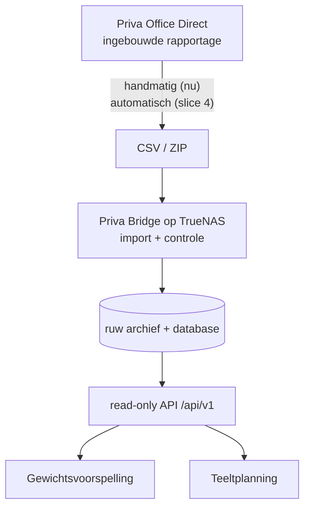

# Priva Bridge – lokaal integratieplan voor TrueNAS

**Versie:** 1.1 | **Datum:** 16 november 2026
**Status:** bouwklaar voor slice 1 t/m 3 (handmatige import, API, historie). Slice 4 (automatische aanvoer) wacht op de Priva-proef uit sectie 4.
**Doel:** één betrouwbare, veilige gegevensbron met Priva-data voor de eigen tuinbouwapps, bij voorkeur zonder extra Priva-abonnement.

**Wat is nieuw in 1.1**

- Scope van versie 1 afgebakend op de twee apps die de data nu echt nodig hebben.
- Kasindeling, afdelingen en lichtmodules ingevuld; kranen boven 40 blijven open.
- Voorlopige meetwaardencatalogus op basis van de eerder bekeken voorbeeldrapporten.
- API-contract uitgeschreven: scopes, velden, paginering, fouten, tokens.
- Installatie als één container via het Custom App-formulier, zonder YAML.
- Fasering omgezet naar verticale slices met een missie-prompt per slice.
- Open punten hebben elk een standaardkeuze, zodat de bouw er niet op wacht.

---

## 1. Uitgangspunten

### 1.1 Priva en server

- **Priva Office Direct 9.7.17, build 9659**, op een eigen Windows-server. Services voor datalogging, databasebeheer en rapportage draaien.
- **Rapportage is gelicentieerd.** De optie 'Exporteren 5 minuten waarden' is **niet** gelicentieerd.
- De beheerder heeft Windows-administratorrechten.
- Verversing: **eenmaal per dag** is genoeg.
- Host: **TrueNAS SCALE 25+**. De Core Ultra mini-pc blijft gereserveerd voor de filmstudio.
- Geen extra API-abonnement, geen wijziging aan klimaatinstellingen.

### 1.2 Kasindeling (vastgelegd)

| Onderdeel | Indeling |
|---|---|
| Kappen | 40 kappen, 6 bedden per kap |
| Afdeling 1 | kap 1–9 |
| Afdeling 2 | kap 10–18 |
| Afdeling 3 | kap 19–30 |
| Afdeling 4 | kap 31–40 |
| Kranen | kraan 1–40 → kap 1–40 |
| Kranen/strengen boven 40 | `unmapped` tot de betekenis is gecontroleerd (41–44 of 41–45: uit de fixtures bepalen) |
| Lichtmodule 1–40 | kap 1–40, lamptype 80 µmol |
| Lichtmodule 101–140 | kap 1–40 in dezelfde volgorde, lamptype 120 µmol (dimbaar) |

Beide lamptypes hangen in dezelfde kap, samen 200 µmol. De huidige situatie geldt sinds augustus 2024. De data van eerdere lampconfiguraties (SON-T, daarna SON-T plus eerste LED) zijn nog niet bekend; zie open punt O5.

De nummering van de afdelingen in Priva (1 t/m 4 in bovenstaande volgorde) is aangenomen en wordt bij de eerste import gecontroleerd.

### 1.3 Bevestigd versus nog te controleren

| Onderdeel | Status | Gevolg |
|---|---|---|
| Office Direct 9.7.17 en draaiende datalogger | Getoond op screenshot | Lokale rapportagebron is aanwezig |
| Rapportage gelicentieerd | Getoond op screenshot | Eerste route: standaard CSV-rapportage |
| Handmatige wekelijkse CSV-export | Werkt nu al | Slice 1 t/m 3 kunnen direct gebouwd worden |
| Continue 5-minutenexport | **Niet gelicentieerd** | Niet op rekenen, niet omzeilen |
| Dagelijkse automatische CSV-rapporten in 9.7.17 | **Nog testen** | Bepaalt alleen slice 4 |
| SQL Server extern leesbaar | **Niet vastgesteld** | Geen databasekoppeling zonder leveranciersspecificatie |
| Priva POSYS bruikbaar | **Onbekend** | Geen onderdeel van dit plan |
| Volledigheid historie en meetpuntdefinities | **Nog controleren** | Gebeurt in slice 3 |

---

## 2. Scope van versie 1

### 2.1 Afnemers

| App | Rol in v1 | Wat hij van de Bridge nodig heeft |
|---|---|---|
| **Gewichtsvoorspelling** | Eerste afnemer | Dagwaarden per kap en afdeling: lampuren en lichtsom, etmaaltemperatuur, vocht, schermuren. Dekking per dag, zodat een ontbrekende dag nooit als 0 telt |
| **Teeltplanning** | Tweede afnemer | Dezelfde dagwaarden als gerealiseerd klimaat en licht, over langere perioden, plus actualiteit |
| GWB-registratie | Niet in v1 | GWB is multi-tenant SaaS voor meerdere telers en mag niet afhangen van één lokale Bridge. Later eventueel als optionele koppeling per tenant |
| Scoutapp, arbeid, onderhoud | Niet in v1 | Bestaan nog niet. De API is generiek genoeg om ze later aan te sluiten; er wordt nu niets specifieks voor gebouwd |

### 2.2 Gevolg voor de huidige werkwijze

De wekelijkse handmatige upload van Priva-exports verhuist van de gewichtsapp naar de Bridge. De gewichtsapp leest daarna uit de Bridge-API. Zolang de Bridge nog niet bewezen is, blijft de bestaande CSV-route in de gewichtsapp als terugval bestaan.

### 2.3 Geplande en gerealiseerde belichting

- **Gerealiseerd** (wat er echt gebrand heeft): komt uit Priva, via de Bridge.
- **Gepland** (het belichtingsschema): blijft Excel-invoer in de teeltplanning. Dat is geen Bridge-data.

### 2.4 Buiten scope

- Elke vorm van schakelen, sturen of instellen richting Priva.
- Directe SQL-toegang tot de Priva-database.
- Weer- en marktdata; die horen in de teeltplanning zelf.

---

## 3. Architectuur



### 3.1 Vastgelegde technische keuzes

| Onderwerp | Keuze | Reden |
|---|---|---|
| Verpakking | **Eén container-image**, te installeren via het Custom App-formulier | Installatie zonder YAML, zoals bij de gewichtsapp |
| Taal en framework | Python 3.12+, FastAPI | Zelfde stack als de andere apps |
| Database | **SQLite (WAL-modus)** op de dataset; via SQLAlchemy, zodat PostgreSQL later met één instelling (`DATABASE_URL`) kan | Eén container volstaat. Dagwaarden over drie jaar zijn hooguit enkele miljoenen regels. Afnemers lezen via de API, nooit rechtstreeks uit de database |
| Planning | APScheduler in hetzelfde proces | Eén dagelijkse run heeft geen aparte worker nodig |
| Web-UI | Server-side pagina's in dezelfde app | Alleen beheer; geen losse frontend nodig |
| Bron automatisch | SMB-clientbibliotheek in de app (geen mount), read-only account | Werkt binnen één container; geen extra hostconfiguratie |
| Bereikbaarheid | **Alleen intern netwerk.** Niet achter de Cloudflare Tunnel | De gewichtsapp is publiek bereikbaar en haalt de data server-side op; de Bridge zelf hoeft nooit naar buiten |

Dit wijkt af van versie 1.0 (PostgreSQL met Docker Compose). Wil je toch PostgreSQL, dan is dat een tweede app of een YAML-installatie; de code hoeft daarvoor niet te veranderen.

### 3.2 Alternatieven voor de automatische aanvoer (slice 4)

- **A – mailbox:** als Office Direct alleen kan mailen, een intern gebruikte mailbox met strikte bijlagefiltering. Liever niet, vanwege extra beheer.
- **B – kopieertaak:** als Office Direct alleen naar een eigen pad schrijft, een kleine Windows-taak die uitsluitend afgeronde exports kopieert.
- **C – leverancier:** als de export de gegevens niet biedt, Priva of de installateur vragen om een gedocumenteerde read-only view, exportinterface of lokale API, met versiecompatibiliteit en kosten.
- **D – blijven uploaden:** handmatig wekelijks uploaden blijft altijd werken en is de terugval.

---

## 4. Priva-proef (parallel aan slice 1)

Deze proef bepaalt alleen hoe slice 4 eruitziet. Uitvoeren in een rustig moment; **geen** wijzigingen aan serviceconfiguratie, database, firewall of klimaatcomputer.

1. Open de rapportagefunctie en zoek naar **automatische processen**, **geplande rapporten** of **CSV-export**. Menunamen verschillen per versie.
2. Maak van één bestaand rapport (bijvoorbeeld Klimaat) handmatig een CSV over **gisteren** en vergelijk velden en cijfers met het wekelijkse rapport.
3. Controleer of dat rapport **dagelijks automatisch** naar een gekozen map kan. Test met één rapport en één dag.
4. Noteer: bestandsnaam, periode, kolommen, scheidingstekens, tijdstip waarop het bestand klaar is, en of oude bestanden worden overschreven.
5. Controleer welke resolutie het rapport toelaat (dag, uur). Uurwaarden zijn welkom, maar geen voorwaarde.
6. **Uitkomst:** automatisch kan → slice 4 via SMB. Kan niet → alternatief A, B, C of D kiezen. Geen licentie aanschaffen zonder besluit.

Een screenshot van het menu plus één CSV is genoeg om slice 4 definitief te maken.

---

## 5. Meetwaardencatalogus (voorlopig)

Gebaseerd op de eerder bekeken voorbeeldrapporten Klimaat en Belichting. Alles met de status 'bevestigen' wordt bij de eerste import tegen de echte bestanden gecontroleerd. De catalogus staat als bestand in de repository (`catalog/metrics.yaml`) en is zonder codewijziging uit te breiden.

| metric_key | Priva-naam | Rapport | Niveau | Eenheid | Dagaggregatie | Status |
|---|---|---|---|---|---|---|
| `temp_etmaal_avg` / `_min` / `_max` | CompTemp | Klimaat | afdeling | °C | gemiddelde, min, max | Gezien |
| `temp_dag_avg`, `temp_nacht_avg` | CompTemp (dag, nacht) | Klimaat | afdeling | °C | gemiddelde | Gezien |
| `rv_avg` | CompRV | Klimaat | afdeling | % | gemiddelde | Gezien |
| `vochtdeficit_avg` | CompHD | Klimaat | afdeling | g/m³ | gemiddelde | Eenheid bevestigen |
| `abs_vocht_avg` | CompAV | Klimaat | afdeling | g/m³ | gemiddelde | Eenheid bevestigen |
| `dauwpuntsverschil_avg` | DewPointDifference | Klimaat | afdeling | °C | gemiddelde | Gezien |
| `scherm_seconden` (doek 1, 2) | CurtainHours | Klimaat | afdeling | s/dag | som | Welk doek verduistert: bevestigen |
| `scherm_autonoom_seconden` (1–8) | AutonomousCurtainHours | Klimaat | afdeling | s/dag | som | Betekenis doeken bevestigen |
| `par_som_lampen` | Sum_24h_PAR_Growlight | Klimaat | afdeling | mol/m²/dag | som | Eenheid bevestigen |
| `straling_som_berekend` | Sum_24h_CalculatedRadiation | Klimaat | afdeling | J/cm²/dag | som | Eenheid en of lampen meetellen: bevestigen |
| `co2_dosering` | CO2Prog | Klimaat | doseerruimte | ppm | gemiddelde | CompCO2 staat op 0; geen gemeten CO₂ |
| `lamp_brandseconden` | belichtingsrapport, per module en kanaal | Belichting | module → kap | s/dag | som | Betekenis kanaal 1 en 2 bevestigen |
| `lamp_stand` | belichtingsrapport | Belichting | module → kap | % | tijdgewogen gemiddelde | Gezien |
| `lamp_par` | belichtingsrapport | Belichting | module → kap | µmol/m²/s | gemiddelde | Telt het beide lamptypes mee: bevestigen |
| `watergift` | kranenrapport | Kranen | kraan → kap | uit fixture | som | Rapport nog niet bekeken |
| `buitenstraling_som` | ontbreekt | – | bedrijf | J/cm²/dag | som | **Toevoegen aan een rapport** (O3) |
| overige | – | Algemeen Bedrijf, Algemeen Afdeling | bedrijf, afdeling | uit fixture | uit fixture | Rapporten nog niet bekeken |

**Afgeleide waarde in de Bridge:** `lichtsom_lampen_kap` (mol/m²/dag) = per lamptype brandseconden × stand ÷ 100 × µmol van dat lamptype ÷ 1.000.000, opgeteld over beide lamptypes. De µmol per module komt uit `lamp_config` met geldigheidsperiode. Zo rekenen de gewichtsapp en de teeltplanning met hetzelfde getal. Dagen vóór een bekende lampconfiguratie krijgen geen afgeleide waarde, wel de ruwe brandseconden.

Lege kolommen uit de voorbeelden (CalculatedPAR, MeasuredRadiation, MeasuredPAR, Energy_Water) worden herkend en overgeslagen, niet als 0 opgeslagen.

---

## 6. Datamodel

| Entiteit | Belangrijkste velden |
|---|---|
| `site` | id, naam, tijdzone |
| `department` | id, site_id, priva_code, naam, geldig_vanaf, geldig_tot |
| `kap` | id, department_id, kapnummer, oppervlakte_m2, geldig_vanaf, geldig_tot |
| `source_device` | id, type (`kraan`, `module`, `doek`, `sensor`, `doseerruimte`), extern_id |
| `mapping` | source_device_id, kap_id of department_id, geldig_vanaf, geldig_tot, status (`bevestigd`, `aangenomen`, `unmapped`) |
| `lamp_config` | source_device_id, umol, dimbaar, geldig_vanaf, geldig_tot |
| `metric_catalog` | metric_key, betekenis, canonieke_eenheid, aggregatieregel, priva_namen |
| `observation` | metric_id, scope_type, scope_id, source_device_id, lokale_datum, timestamp_utc (leeg bij dagwaarden), aggregation_kind, waarde, kwaliteit, import_id, revisie |
| `import_batch` | bestandsnaam, sha256, rapportfamilie, periode, status, aantallen, parserversie, ontvangen_op |
| `daily_aggregate` | scope, lokale_datum, metric_id, waarde, dekking, versie |
| `api_token` | naam, hash, scopes, laatst_gebruikt, ingetrokken_op |

**Uniekheid:** een observatie is uniek op `(source_point, metric, lokale_datum of timestamp_utc, aggregation_kind, revisie)`. Wijkt een nieuwe import af van een bestaande waarde, dan komt er een nieuwe revisie; de oude blijft bewaard.

**Tijd:** dagwaarden worden opgeslagen op **lokale datum** (`Europe/Amsterdam`) zonder verzonnen tijdstip. Subdagelijkse waarden, als die later komen, in UTC. Dagen van 23 en 25 uur worden getest.

**Eenheden:** omrekenen alleen met een expliciete regel uit de catalogus. Seconden blijven seconden; de API geeft de eenheid altijd mee. Cumulatieve tellers worden niet opgeteld zonder brondefinitie.

**Niveaus:** bedrijf, afdeling, kap en bronapparaat blijven gescheiden. Niet elk meetpunt bestaat per kap.

**Leeg is niet nul:** een leeg veld wordt 'ontbreekt' met dekking 0, nooit de waarde 0.

---

## 7. Importmotor

| Module | Taak | Slice |
|---|---|---|
| `source_manual` | Upload van CSV en ZIP via de web-UI, met preview vóór verwerking | 1 |
| `parser_priva` | Herkent de rapportfamilie op inhoud, niet op bestandsnaam. Ondersteunt UTF-8 en Windows-1252, punt en komma als decimaalteken, puntkomma en tab als scheidingsteken, Nederlandse datumnotaties | 1 (Klimaat, Belichting), 2 (rest) |
| `raw_store` | Bewaart het bronbestand ongewijzigd met SHA-256, ontvangsttijd en parserversie | 1 |
| `ingestion_ledger` | Voorkomt dubbele verwerking op bestands- en meetpuntniveau | 1 |
| `normalizer` | Vertaalt Priva-namen naar `metric_key`, eenheid en locatie via catalogus en mapping | 1 |
| `quality_engine` | Ontbrekende afdelingen, kappen of dagen; plotselinge nullen; dubbele records; uitschieters; onbekende kolommen | 2 |
| `aggregator` | Dagaggregaten met dekking, afgeleide lichtsom | 2 |
| `source_smb` | Leest nieuwe exports van de Windows-share, kopieert stabiele bestanden naar staging | 4 |
| `scheduler` | Dagelijkse run, retry met oplopende wachttijd, gemiste dagen inhalen | 4 |
| `notifications` | Eén samengevatte melding bij afwijkingen | 4 |

**Verplicht:** een onbekende kolom of rapportvariant stopt de import van dat bestand met een duidelijke melding in de UI. Er verdwijnen nooit stilzwijgend records.

---

## 8. API-contract (`/api/v1`)

### 8.1 Authenticatie en fouten

- Header `Authorization: Bearer <token>`. Eén token per afnemende app, aangemaakt in de beheer-UI en alleen bij aanmaak zichtbaar.
- Scopes: `read:data` (alle GET-endpoints), `admin:imports` (upload en herimport).
- De beheer-UI heeft een eigen login met wachtwoord uit een omgevingsvariabele.
- Fouten als `application/problem+json`: `{"type", "title", "status", "detail"}`. Gebruikte codes: 400, 401, 403, 404, 422, 429.
- Rate limit per token; `429` met `Retry-After`.
- De OpenAPI-specificatie staat op `/api/v1/openapi.json` en wordt in de repository vastgelegd. Een wijziging die afnemers breekt, vraagt `/api/v2`.

### 8.2 Scope-notatie

| Notatie | Betekenis |
|---|---|
| `bedrijf` | Hele bedrijf |
| `afdeling:1` t/m `afdeling:4` | Klimaatafdeling |
| `kap:1` t/m `kap:40` | Kap |
| `bron:kraan:41`, `bron:module:101` | Bronapparaat, ook als het nog `unmapped` is |

**Overerving:** met `inherit=true` krijgt een kap voor meetwaarden die alleen per afdeling bestaan de waarde van zijn afdeling. Het veld `resolved_from` zegt dan waar de waarde vandaan komt. Standaard staat overerving uit.

### 8.3 Endpoints

| Endpoint | Betekenis | Slice |
|---|---|---|
| `GET /health` | Leeft de app | 1 |
| `GET /api/v1/status` | Laatste import, laatste complete dag, achterstand, waarschuwingen | 1 |
| `GET /api/v1/metrics` | Catalogus met eenheid, niveau en aggregatie | 1 |
| `GET /api/v1/daily` | Dagwaarden met dekking en kwaliteit | 1 |
| `GET /api/v1/structure` | Afdelingen, kappen, mapping en lampconfiguratie met geldigheid | 2 |
| `GET /api/v1/observations` | Ruwe reeks, gepagineerd | 2 |
| `GET /api/v1/imports` | Importbatches en hun status | 2 |
| `POST /api/v1/imports` | Upload naar de importwachtrij (`admin:imports`) | 3 |
| `GET /api/v1/exports` | Selectie als CSV of Excel | 5 |

### 8.4 `GET /api/v1/daily`

Parameters: `scope` (verplicht, meerdere toegestaan), `from` en `to` (lokale datums, inclusief), `metric` (optioneel, meerdere), `inherit` (standaard `false`), `cursor`, `limit` (standaard 500, maximaal 5000).

```json
{
  "data": [
    {
      "date": "2026-11-15",
      "scope": "kap:12",
      "metric": "lamp_brandseconden",
      "value": 39600,
      "unit": "s",
      "aggregation": "sum",
      "coverage": 1.0,
      "quality": "ok",
      "resolved_from": "kap:12",
      "sources": ["bron:module:12", "bron:module:112"],
      "import_id": "imp_0193",
      "revision": 1
    }
  ],
  "next_cursor": null,
  "freshness": {
    "last_import_at": "2026-11-16T04:07:00+01:00",
    "last_complete_date": "2026-11-15"
  }
}
```

- `coverage`: deel van de verwachte bronwaarden dat aanwezig was (0 tot 1).
- `quality`: `ok`, `verdacht`, `onvolledig` of `ontbreekt`. Bij `ontbreekt` is `value` gelijk aan `null`, nooit 0.
- Een gevraagde dag zonder data komt terug als regel met `ontbreekt`, zodat de afnemer het gat ziet.

### 8.5 `GET /api/v1/observations`

Zelfde parameters en velden als `daily`, plus `timestamp_utc` (leeg bij dagwaarden) en alle revisies met `include_revisions=true`. Paginering met `cursor`.

### 8.6 `GET /api/v1/status`

```json
{
  "last_import_at": "2026-11-16T04:07:00+01:00",
  "last_complete_date": "2026-11-15",
  "missing_dates": [],
  "warnings": [
    {"code": "unknown_column", "detail": "Klimaat: kolom 'X' niet in catalogus", "since": "2026-11-16"}
  ],
  "source_mode": "manual"
}
```

---

## 9. Beheer-UI

| Onderdeel | Slice |
|---|---|
| Statusoverzicht met kalender van de laatste 30 dagen (compleet, onvolledig, ontbreekt) | 1 |
| Upload met preview: herkend rapport, periode, aantal regels, onbekende kolommen | 1 |
| Importlijst met fouten en herimport | 2 |
| Mapping-editor: afdelingen, kappen, kranen, modules, lampconfiguratie, met geldigheidsperiode en bevestiging | 2 |
| Nieuwe, nog niet gecatalogiseerde meetpunten | 2 |
| Historische import in batches met voortgang | 3 |
| Broninstellingen en planning | 4 |
| API-tokens, back-upstatus, export | 5 |

Technische foutdetails zijn alleen zichtbaar in deze beheer-UI. Afnemende apps krijgen alleen de foutcodes uit 8.1.

---

## 10. Installatie op TrueNAS zonder YAML

1. Maak een dataset aan, bijvoorbeeld `priva-bridge`.
2. Apps → Discover Apps → Custom App.
3. Application Name: `priva-bridge`.
4. Image: repository en tag van de image die Claude Code bouwt en in een register zet (bijvoorbeeld GitHub Container Registry).
5. Omgevingsvariabelen:

| Variabele | Betekenis |
|---|---|
| `TZ` | `Europe/Amsterdam` |
| `BRIDGE_ADMIN_PASSWORD` | Wachtwoord voor de beheer-UI |
| `BRIDGE_SECRET_KEY` | Sleutel voor sessies en tokenhashes |
| `DATABASE_URL` | Leeg laten voor SQLite in `/data` |
| `SMB_HOST`, `SMB_SHARE`, `SMB_USER`, `SMB_PASSWORD` | Pas vanaf slice 4 |
| `NOTIFY_WEBHOOK_URL` | Optioneel, vanaf slice 4 |

6. Netwerk: containerpoort 8000 naar een vrije poort op de TrueNAS.
7. Opslag: Host Path, de dataset, in de container als `/data`. Daarin komen `db/`, `raw/`, `staging/` en `backups/`.
8. Installeren en openen via de poort.

**Bijwerken:** de tag aanpassen. Databasemigraties draaien automatisch bij het starten; vóór elke migratie maakt de app een kopie van de database in `/data/backups`.

**Back-up:** dagelijkse ZFS-snapshots van de dataset, plus de bestaande back-uproutine. De hersteltest zit in slice 5.

De veldnamen in het formulier kunnen per TrueNAS-versie iets verschillen.

---

## 11. Bouwvolgorde in slices

Elke slice levert iets op dat op zichzelf werkt. De missie-prompts zijn bedoeld om samen met de projectopdracht uit sectie 16 aan Claude Code te geven.

### Slice 0 – Aanleveren (Leon)

- De vijf voorbeeld-CSV's, het liefst over dezelfde week en met alle vier de afdelingen.
- Antwoorden op de open punten in sectie 12, voor zover bekend.
- Parallel: de Priva-proef uit sectie 4.

**Klaar wanneer:** de bestanden staan in `tests/fixtures/` van de repository.

### Slice 1 – Van upload tot dagwaarde

Eén container, upload, parsers voor Klimaat en Belichting, ruw archief, ledger, catalogus, vaste mapping uit 1.2, `/health`, `/status`, `/metrics`, `/daily`, tokens via een opstartcommando, statuspagina.

**Klaar wanneer:**
- de app via het formulier op TrueNAS draait;
- beide voorbeeldrapporten importeren zonder handwerk;
- driemaal hetzelfde bestand uploaden geen dubbele records geeft;
- tien steekproefwaarden uit `/daily` gelijk zijn aan het Priva-rapport;
- de gewichtsapp zijn licht- en klimaatdata uit `/daily` haalt.

> **Missie slice 1:** Bouw de Priva Bridge als één container (FastAPI, SQLAlchemy, SQLite in `/data`). Implementeer `source_manual`, `raw_store`, `ingestion_ledger`, `parser_priva` voor de fixtures Klimaat en Belichting, `normalizer` met `catalog/metrics.yaml` en de vaste mapping uit sectie 1.2, en de endpoints `/health`, `/api/v1/status`, `/api/v1/metrics` en `/api/v1/daily` exact volgens sectie 8. Schrijf eerst tests op de fixtures, inclusief decimale komma, leeg veld versus nul en dubbele upload. Leg de OpenAPI-specificatie vast in de repository. Lever een Dockerfile en de installatiestappen uit sectie 10.

### Slice 2 – Alle rapporten, mapping en kwaliteit

Parsers voor Kranen, Algemeen Bedrijf en Algemeen Afdeling; mapping-editor met geldigheid; lampconfiguratie en afgeleide lichtsom; `quality_engine`; `/structure`, `/observations`, `/imports`.

**Klaar wanneer:** alle vijf rapportfamilies importeren, kranen boven 40 als `unmapped` zichtbaar zijn, en een onbekende kolom een melding geeft in plaats van een stille fout.

> **Missie slice 2:** Voeg de drie resterende parsers toe op basis van de fixtures, de mapping-editor met geldigheidsperioden en bevestigingsstatus, `lamp_config` met de afgeleide `lichtsom_lampen_kap`, de `quality_engine` en de endpoints `/structure`, `/observations` en `/imports`. Test tijdsafhankelijke mapping, overerving met `inherit=true`, en dagen van 23 en 25 uur.

### Slice 3 – Historie

ZIP-upload, import in batches met preview en voortgang, revisies bij afwijkende waarden, `POST /imports`, overzicht van ontbrekende perioden.

**Klaar wanneer:** drie jaar historie is geïmporteerd, de gaten zichtbaar zijn, en dagen vóór de bekende lampconfiguratie geen afgeleide lichtsom hebben.

> **Missie slice 3:** Maak historische backfill mogelijk: ZIP-upload, batchverwerking met preview en voortgang, revisiebeheer bij gewijzigde waarden, en een gatenrapport per rapportfamilie en afdeling. De import moet herstartbaar zijn na een onderbreking.

### Slice 4 – Automatische aanvoer

Vorm volgt uit de Priva-proef. Bij SMB: zie sectie 13 voor de inrichting op Windows.

**Klaar wanneer:** veertien dagen achter elkaar elke verwachte export zonder handwerk binnenkomt, of elk gemist bestand een melding gaf en automatisch is ingehaald. Een dag bronuitval geeft geen crash.

> **Missie slice 4:** Voeg `source_smb` (clientbibliotheek, read-only, stabiliteitscontrole op grootte en wijzigingstijd, kopie naar staging vóór het hashen), `scheduler` (dagelijkse run, retries, inhalen van gemiste dagen, hercontrole van de laatste zeven dagen) en `notifications` (één samengevatte melding via webhook) toe. Houd de bronadapter achter één interface, zodat `source_manual` en een latere bron dezelfde pijplijn gebruiken. **Wijzig niets op de Priva-server; lever alleen een stappenlijst voor Leon.**

### Slice 5 – Afronding

Tokenbeheer in de UI, export, back-upstatus, hersteltest op een schone installatie, volledige acceptatie.

> **Missie slice 5:** Voeg tokenbeheer, `/exports` en de back-upstatus toe. Schrijf een herstelprocedure en voer hem uit op een schone container. Loop de acceptatiecriteria uit sectie 14 af en rapporteer per criterium het bewijs.

### Inschatting

| Slice | Indicatie met Claude Code en actieve review |
|---|---|
| 1 | 2–4 dagen |
| 2 | 2–4 dagen |
| 3 | 1–3 dagen |
| 4 | 1–3 dagen, na de Priva-proef |
| 5 | 1–2 dagen |

Dit is een globale inschatting, geen offerte. De echte CSV-varianten bepalen de spreiding. Priva-kosten: mogelijk €0 als de bestaande rapportage geplande export ondersteunt; dat is nog niet bevestigd.

---

## 12. Open punten met standaardkeuze

De bouw wacht nergens op: bij geen antwoord geldt de standaard.

| Nr | Vraag | Standaard als het antwoord ontbreekt | Raakt |
|---|---|---|---|
| O1 | Waar horen kranen of strengen boven 40 bij? | `unmapped`, wel opgeslagen en opvraagbaar via `bron:kraan:N` | Slice 2 |
| O2 | Kunnen afdeling 2, 3 en 4 in het klimaatrapport? | Alleen afdeling 1 wordt geïmporteerd; de andere tonen als `ontbreekt` | Slice 1 |
| O3 | Kan de buitenstraling van het weerstation als dagsom in een rapport? | Metric blijft leeg; daglicht kan niet per fase berekend worden | Gewichtsmodel |
| O4 | Wat zijn kanaal 1 en 2 bij de lichtmodules, en telt de PAR beide lamptypes mee? | Beide kanalen apart opslaan; afgeleide lichtsom alleen uit brandseconden en stand | Slice 2 |
| O5 | Vanaf welke data golden de eerdere lampconfiguraties? | Afgeleide lichtsom alleen vanaf augustus 2024 | Slice 3 |
| O6 | Welk doek is het verduisteringsdoek, en wat zijn autonoom doek 1–8? | Alle doeken apart opslaan onder hun Priva-naam | Slice 1 |
| O7 | Eenheden van vochtdeficit, CalculatedRadiation en watergift | Eenheid `onbevestigd` in de catalogus; waarde ongewijzigd doorgeven | Slice 1–2 |
| O8 | Is er een CO₂-meter? CompCO2 staat op 0 | Alleen de dosering opslaan | Slice 1 |
| O9 | Hoe wil je meldingen ontvangen? | Statuspagina, plus optionele webhook | Slice 4 |
| O10 | SQLite of toch PostgreSQL? | SQLite | Slice 1 |
| O11 | Mag de image openbaar in een register? Er zit geen bedrijfsdata in | Privé-register | Slice 1 |
| O12 | Uitkomst van de Priva-proef | Handmatig blijven uploaden | Slice 4 |

---

## 13. Security en continuïteit

1. **Niets installeren of wijzigen op de Priva-server** zonder afzonderlijke, expliciete goedkeuring. Claude Code levert voor Windows alleen stappenlijsten.
2. **Geen SQL-query's op productie** zonder leveranciersgoedkeuring, schema, serviceaccount en belastinglimiet. Nooit schrijven in Priva-tabellen.
3. **Poorten 8080, 1010, 9876 en 3341 niet aanspreken**: het zijn interne Priva-services, geen bevestigde integratie-interfaces.
4. **Eigen account met minimale rechten** voor de dagelijkse import; geen Priva-rollen of Windows-adminwachtwoorden.
5. **Geen internettoegang** naar de Priva-server of de share. Geen portforwarding. De Bridge zelf blijft ook intern.
6. **Veilig falen:** bij storing alleen waarschuwingen en achterstand, nooit invloed op de klimaatregeling.
7. **Back-up** van database, mapping, catalogus en ruwe bestanden via snapshots en de bestaande routine. Geheimen alleen in omgevingsvariabelen. Hersteltest verplicht.
8. **Toestemming:** alleen de eigenaar beslist over koppelingen op de Priva-server; onderhoudsvoorwaarden van Priva of de installateur vooraf nagaan.

### Inrichting op Windows voor slice 4 (uit te voeren door Leon, na goedkeuring)

- Nieuwe map, bijvoorbeeld `PrivaBridgeExports`, op een geschikt volume. Bestaande Priva-mappen blijven onaangeroerd.
- Lokale gebruiker `priva_bridge_reader` met **alleen lezen** op die map.
- Delen via **SMB3**, geen SMB1. Windows Firewall beperken tot het IP van de TrueNAS.
- Mag inkomend SMB niet, dan een goedgekeurde uitgaande push (SFTP of HTTPS) vanuit een kleine Windows-taak.
- Een export telt pas als compleet wanneer grootte en wijzigingstijd stabiel zijn en het formaat valideert.

### Dagelijkse verwerking (vanaf slice 4, tijden instelbaar)

| Tijd | Taak | Bij mislukken |
|---|---|---|
| 03:00 | Priva maakt de rapporten over gisteren | Priva loopt gewoon door |
| 04:00 | Bridge controleert ontvangst en stabiliteit | Opnieuw proberen; bronbestanden nooit verwijderen |
| 04:05 | Hash, validatie, import, normalisatie | Transactie terugdraaien, fout vastleggen |
| 04:15 | Dagaggregaten en kwaliteitsrapport | Dag markeren als onvolledig |
| 07:00 | Melding bij fouten | Eén samengevatte waarschuwing |

De laatste zeven dagen worden elke run opnieuw gecontroleerd op achteraf gewijzigde brondata. Na stroomuitval herkent de Bridge zelf welke dagen ontbreken.

---

## 14. Acceptatiecriteria

**Na slice 1–3**

- [ ] Installatie via het Custom App-formulier, zonder YAML.
- [ ] Alle vijf rapportfamilies importeren uit de echte bestanden.
- [ ] Hetzelfde bestand driemaal importeren: geen dubbele records.
- [ ] Dertig steekproefwaarden en dagaggregaten kloppen met de Priva-rapporten.
- [ ] Mapping getest voor vier afdelingen, kraan en kap 1–40, modules 1–40 en 101–140, kranen boven 40 en tijdsafhankelijke toewijzing.
- [ ] Leeg veld versus echte nul, decimale komma, ontbrekende afdeling en onbekende kolom getest.
- [ ] Zomer- en wintertijdwissel getest.
- [ ] `/daily` geeft bij elke waarde eenheid, dekking, kwaliteit en herkomst.
- [ ] De gewichtsapp en de teeltplanning gebruiken alleen de Bridge-API.
- [ ] Drie jaar historie geïmporteerd; gaten zichtbaar.

**Na slice 4–5**

- [ ] Geen extra Priva-abonnement nodig, of een geaccepteerd alternatief is vastgelegd.
- [ ] Priva Office en de klimaatregeling werken exact als voorheen.
- [ ] Veertien dagen onbeheerde import; elk gemist bestand gemeld en ingehaald.
- [ ] Eén dag bronuitval: geen crash, daarna automatisch inhalen, duidelijke actualiteitsstatus.
- [ ] Herstel van database, mapping en ruwe bestanden op een schone installatie.
- [ ] Controle: geen schrijfrechten of stuurfunctie richting Priva aanwezig.
- [ ] De Bridge is niet van buiten het interne netwerk bereikbaar.

---

## 15. Risico's

| Risico | Maatregel |
|---|---|
| Automatische rapportage niet beschikbaar in 9.7.17 | Slice 1–3 hangen er niet van af; daarna alternatief A–D |
| 5-minutenexport niet gelicentieerd | Werken met de beschikbare resolutie; niet omzeilen |
| Kolommen veranderen na een Priva-update | Parserversies, detectie van onbekende kolommen, ruw archief voor herimport |
| Voorbeeldrapporten onvolledig (alleen afdeling 1) | Open punt O2; ontbrekende afdelingen tonen als `ontbreekt` |
| Belasting van de Priva-server | Rapportage buiten piekuren; al het rekenwerk op TrueNAS |
| Ontbrekende data tijdens prognoses | Dekking en kwaliteit in elke respons; terugval op de bestaande CSV-route |
| Dubbeltellingen bij twee lamptypes of cumulatieve meters | Eén afgeleide lichtsom in de Bridge; aggregatieregel per metric |
| SQLite wordt te krap | Datalaag via SQLAlchemy; overstap met `DATABASE_URL` |
| Onbekende historische lampconfiguratie | Geen afgeleide lichtsom vóór bekende periode; ruwe uren blijven beschikbaar |

---

## 16. Projectopdracht aan Claude Code

> Bouw een zelfstandige **Priva Bridge** voor mijn TrueNAS SCALE 25+ volgens `Priva_Bridge_TrueNAS_implementatieplan_v1.1.md` in deze repository. Dat document is leidend; wijk er alleen van af na overleg.
>
> **Harde grenzen**
> - Wijzig of installeer niets op de Priva-productieserver. Lever voor Windows alleen stappenlijsten en vraag vooraf goedkeuring.
> - Geen ongedocumenteerde Priva-poorten, geen toegang tot de Priva-database, geen aansturing van klimaatinstellingen.
> - De consumenten-API uit sectie 8 is een contract: wijzig hem niet zonder een nieuwe versie.
> - Een leeg veld is nooit 0. Er verdwijnen nooit stilzwijgend records.
>
> **Techniek**
> - Eén container-image: Python 3.12+, FastAPI, SQLAlchemy, SQLite in `/data` (PostgreSQL mogelijk via `DATABASE_URL`), APScheduler, server-side beheer-UI.
> - Installatie via het Custom App-formulier van TrueNAS, zonder YAML (sectie 10).
> - Bronadapters achter één interface, zodat een latere bron de API niet verandert.
> - Catalogus en standaardmapping als versiebeheerde bestanden.
>
> **Werkwijze**
> - Werk per slice uit sectie 11 en stop na elke slice voor review.
> - Schrijf eerst tests op de echte bestanden in `tests/fixtures/`. Raad geen formaat: ontbreekt een fixture, vraag erom.
> - Bij een open punt uit sectie 12 zonder antwoord geldt de standaardkeuze; noteer dat in `DECISIONS.md`.
> - Rapporteer na elke slice per 'klaar wanneer'-punt het bewijs.
>
> Begin met slice 1.

---

## 17. Bronnen

- Priva over het verschil tussen on-premises Office Direct en cloud Operator: <https://support.priva.com/hc/en-us/articles/360020950592-How-does-Priva-Operator-compare-to-Priva-Office-Direct>
- Oudere productbrochure van Office Direct over automatische processen, geplande CSV/PDF-rapporten en de aparte 5-minutenexport. Ondersteunt de proef, niet de aanname dat 9.7.17 identiek is: <https://manualzilla.com/doc/5857922/pdf-data-sheet>
- Priva FS Performance Essentials noemt lokale API- en databasekoppelingen; dat geldt niet automatisch voor Office Direct 9.7: <https://www.priva.com/nl/tuinbouw/oplossingen/arbeid-en-gewasbeheer/priva-fs-performance/priva-fs-performance-essentials>
- Publicatie over de oudere POSYS Windows-DLL voor een andere Priva-procescomputer; compatibiliteit niet aangetoond: <https://orbit.dtu.dk/files/128123505/EUDP_FinalReport_SmartGridReady.pdf>
- Priva's cloud Horticulture API, het alternatief als lokale export niet volstaat: <https://support.priva.com/hc/en-us/articles/24540860994972-Can-I-use-APIs-with-the-Priva-Compass>
- TrueNAS, eigen apps installeren via het formulier: <https://apps.truenas.com/managing-apps/installing-custom-apps/index.html>

De Priva-bronnen zijn overgenomen uit versie 1.0 en voor deze versie niet opnieuw gecontroleerd. De meetwaarden in sectie 5 komen uit eerder bekeken voorbeeldrapporten en worden bij de eerste import tegen de echte bestanden getoetst.

---

**Volgende handeling:** de vijf voorbeeld-CSV's in de repository zetten en slice 1 starten met de projectopdracht uit sectie 16. De Priva-proef uit sectie 4 kan er los naast.
